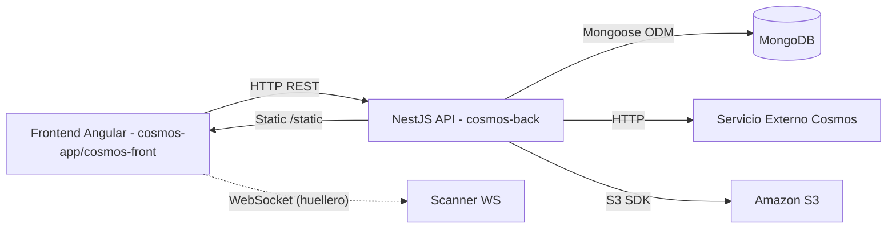

# Cosmos - Resumen Técnico Funcional (Borrador)

## 1. Resumen General y Arquitectura

- Propósito: Plataforma web para gestión de asistencias/“marcaciones”, empleados, usuarios, roles/permissions, puntos de marcación y capacitaciones (talks). Integra captura de huellas (Capacitor plugin + ZKTeco), reconocimiento facial (face-api.js en backend) y consumo de datos externos (servicio Cosmos) para “nombradas”.

## 2. Backend (NestJS)

- Módulos principales (src/modules): Auth, User, Role, Permission, Port, Point, Entry, Employee, Named (integración externa), Upload (S3), Models (estáticos), Talk, Assistant, Fingerprint, Generator, Presition, Trainer.

| Módulo | Responsabilidad |
|---|---|
| Auth | Autenticación (Local/JWT), guards, perfiles |
| User | Gestión de usuarios y roles asociados |
| Role | Gestión de roles |
| Permission | Permisos por puerto |
| Port | Puertos (CRUD) |
| Point | Puntos de marcación, tolerancias y dependencias |
| Entry | Entradas/ausencias, validaciones y dashboard |
| Employee | Empleados, firma, rostro y sincronización externa |
| Named | Integración con servicio Cosmos (tokens, nombradas, usuarios) |
| Upload | Subida/eliminación de archivos en S3 |
| Models | Exploración de archivos estáticos en /public/models |
| Talk | Charlas/capacitaciones (CRUD y búsquedas) |
| Assistant | Asistentes a charlas |
| Fingerprint | Huellas dactilares de empleados |
| Generator | Generación de QR y subida |
| Presition | Configuración de precisión |
| Trainer | Instructores/registradores |

- Prefijo global: `api/v1`. Swagger en `/api`. CORS habilitado. Mongo URI: `process.env.MONGO_URI`.

### 2.1 Endpoints por módulo (extracto)

Auth

| Método | Ruta | Controlador.Método | Descripción |
|---|---|---|---|
| POST | /auth/register | AuthController.register | Registro de usuario (solo SUPER_ADMIN) |
| POST | /auth/login | AuthController.login | Inicio de sesión (LocalStrategy) |
| GET | /auth/profile | AuthController.getProfile | Perfil de usuario autenticado |

User

| Método | Ruta | Controlador.Método | Descripción |
|---|---|---|---|
| GET | /user | UserController.findAll | Lista usuarios |
| POST | /user | UserController.create | Crear usuario (imagen opcional) |
| GET | /user/except-super/:limit/:page | UserController.findAllExceptSuper | Lista sin SUPER |
| GET | /user/by-id/:id | UserController.findById | Obtener por id |
| GET | /user/:limit/:page | UserController.findByPagination | Lista paginada |
| GET | /user/:id | UserController.findOne | Obtener por id |
| PATCH | /user/:id | UserController.update | Actualizar (imagen opcional) |
| DELETE | /user/:id | UserController.remove | Eliminar |

Employee

| Método | Ruta | Controlador.Método | Descripción |
|---|---|---|---|
| GET | /employee/loggued | EmployeeController.getLogguedIn | Verifica login |
| GET | /employee | EmployeeController.findAll | Lista empleados |
| GET | /employee/search/:document | EmployeeController.searchEmployee | Buscar por DNI |
| GET | /employee/:id | EmployeeController.findOne | Obtener por id |
| GET | /employee/by-id-bs/:id | EmployeeController.getByIdBS | Buscar por id (BS) |
| POST | /employee | EmployeeController.create | Crear empleado (imagen) |
| POST | /employee/signature | EmployeeController.saveSignature | Guardar firma (archivo) |
| PATCH | /employee/:id | EmployeeController.update | Actualizar (imagen) |
| PATCH | /employee/:id/register-face | EmployeeController.registerFace | Guardar descriptor facial |
| PATCH | /employee/:employeeId | EmployeeController.updateFingerprintStatus | Actualizar estado de huella |
| DELETE | /employee/:id | EmployeeController.remove | Eliminar |
| POST | /employee/check-in | EmployeeController.checkIn | Match facial con base |
| POST | /employee/sync-from-named | EmployeeController.syncEmployeesFromNamed | Sincroniza desde servicio externo |
| GET | /employee/models | EmployeeController.getModelsInfo | Lista JSON de modelos |
| GET | /employee/models/:fileName | EmployeeController.getModelFile | Contenido JSON de modelo |

Entry

| Método | Ruta | Controlador.Método | Descripción |
|---|---|---|---|
| POST | /entry | EntryController.create | Crear entrada/ausencia |
| POST | /entry/manual | EntryController.createManual | Crear entrada manual |
| POST | /entry/checkin | EntryController.checkin | Checkin validando reglas |
| GET | /entry | EntryController.findAll | Listar |
| POST | /entry/search | EntryController.search | Buscar (agrupado) |
| GET | /entry/:id | EntryController.findOne | Ver por id |
| PATCH | /entry/:id | EntryController.update | Actualizar |
| DELETE | /entry/:id | EntryController.remove | Eliminar |
| GET | /entry/employee/:id/:staffTransmissionId/:date | EntryController.getEntriesByEmployeeId | Entradas por empleado y fecha |
| GET | /entry/employee-and-named/:id/:staffTransmissionId/:date | EntryController.getEntriesByEmployeeIdAndNamedId | Entradas + named |
| GET | /entry/remate/:employeeId | EntryController.remate | Cerrar/abrir siguiente named |
| POST | /entry/dashboard | EntryController.dashboard | Resumen panel |
| POST | /entry/dashboard/assistances | EntryController.dashboardAssistances | Detalle asistencias |
| POST | /entry/dashboard/nameds | EntryController.dashboardNameds | Resumen nombradas |
| GET | /entry/dashboard/filters | EntryController.getDashboardFilters | Filtros |
| POST | /entry/cancel-absence | EntryController.cancelAbsence | Cancelar falta |

Fingerprint

| Método | Ruta | Controlador.Método | Descripción |
|---|---|---|---|
| POST | /fingerprint/save | FingerprintController.saveFingerprint | Guardar template de huella |
| POST | /fingerprint/identity | FingerprintController.identifyFingerprint | Identificar por template |
| GET | /fingerprint | FingerprintController.findAll | Listar huellas |
| DELETE | /fingerprint/by-employee-id/:id | FingerprintController.deleteFingerprintByEmployeeId | Eliminar por empleado |

Named

| Método | Ruta | Controlador.Método | Descripción |
|---|---|---|---|
| POST | /named | NamedController.getToken | Obtener token externo |
| POST | /named/users | NamedController.getAllUsers | Listar usuarios externos |
| POST | /named/users/doc | NamedController.getUserByDoc | Usuario por doc |
| POST | /named/nameds | NamedController.getNameds | Nombradas |
| POST | /named/nameds/grouped | NamedController.getNamedsGrouped | Nombradas agrupadas |
| POST | /named/date-turn | NamedController.getNamesByDateAndTurn | Empleados por fecha/turno |
| POST | /named/generate-random-entries | NamedController.generateRandomEntries | Genera entradas aleatorias |

Point

| Método | Ruta | Controlador.Método | Descripción |
|---|---|---|---|
| POST | /point | PointController.create | Crear punto |
| GET | /point/by-employee/:employeeId | PointController.findAllByEmployeeId | Puntos actuales por empleado |
| GET | /point/:limit/:page | PointController.findAll | Listar paginado |
| GET | /point/by-port/:portId/:limit/:page | PointController.findAllByPortId | Listar por puerto |
| GET | /point/:id | PointController.findOne | Ver detalle |
| PATCH | /point/:id | PointController.update | Actualizar |
| DELETE | /point/:id | PointController.remove | Eliminar |

Port

| Método | Ruta | Controlador.Método | Descripción |
|---|---|---|---|
| POST | /port | PortController.create | Crear puerto |
| GET | /port/:limit/:page | PortController.findAll | Listar paginado |
| GET | /port/:id | PortController.findOne | Ver detalle |
| PATCH | /port/:id | PortController.update | Actualizar |
| DELETE | /port/:id | PortController.remove | Eliminar |

Role

| Método | Ruta | Controlador.Método | Descripción |
|---|---|---|---|
| POST | /role | RoleController.create | Crear rol |
| GET | /role | RoleController.findAll | Listar roles |
| GET | /role/:id | RoleController.findOne | Ver detalle |
| PATCH | /role/:id | RoleController.update | Actualizar |
| DELETE | /role/:id | RoleController.remove | Eliminar |

Permission

| Método | Ruta | Controlador.Método | Descripción |
|---|---|---|---|
| POST | /permission | PermissionController.create | Crear permiso |
| GET | /permission | PermissionController.findAll | Listar permisos |
| GET | /permission/:id | PermissionController.findOne | Ver detalle |
| PATCH | /permission/:id | PermissionController.update | Actualizar |
| DELETE | /permission/:id | PermissionController.remove | Eliminar |

Talk

| Método | Ruta | Controlador.Método | Descripción |
|---|---|---|---|
| POST | /talk | TalkController.create | Crear charla |
| GET | /talk | TalkController.findAll | Listar |
| GET | /talk/date/:startDate/:endDate/:limit/:page | TalkController.getTalkByDate | Listar por rango |
| POST | /talk/search?limit&page | TalkController.search | Buscar con filtros |
| GET | /talk/:id | TalkController.findOne | Ver detalle |
| PATCH | /talk/:id | TalkController.update | Actualizar |
| DELETE | /talk/:id | TalkController.remove | Eliminar |

Assistant

| Método | Ruta | Controlador.Método | Descripción |
|---|---|---|---|
| POST | /assistant | AssistantController.create | Agregar asistente |
| POST | /assistant/save-by-employee-ids | AssistantController.saveByEmployeeIds | Guardar por lista |
| GET | /assistant | AssistantController.findAll | Listar |
| GET | /assistant/talk/:talkId | AssistantController.getByTalkId | Listar por charla |
| GET | /assistant/:id | AssistantController.findOne | Ver detalle |
| PATCH | /assistant/:id | AssistantController.update | Actualizar |
| DELETE | /assistant/delete-by-employee-id/:id | AssistantController.deleteByEmployeeId | Eliminar por empleado |
| DELETE | /assistant/delete-by-talk-id/:talkId | AssistantController.deleteByTalkId | Eliminar por charla |
| DELETE | /assistant/:id | AssistantController.remove | Eliminar |

Upload

| Método | Ruta | Controlador.Método | Descripción |
|---|---|---|---|
| POST | /upload | UploadController.uploadImage | Subir a S3 |
| DELETE | /upload/:key | UploadController.deleteFile | Eliminar de S3 |

- Auth (`auth.controller.ts`)
  - POST /auth/register → AuthService.register
  - POST /auth/login → AuthService.login (LocalStrategy)
  - GET /auth/profile → perfil JWT

- User (`user.controller.ts` - JWT+Roles)
  - GET /user → listar; GET /user/except-super/:limit/:page; GET /user/by-id/:id; GET /user/:limit/:page; GET /user/:id
  - POST /user (multipart image)
  - PATCH /user/:id (multipart image)
  - DELETE /user/:id

- Employee (`employee.controller.ts` - JWT+Roles)
  - GET /employee/loggued; GET /employee; GET /employee/search/:document; GET /employee/:id; GET /employee/by-id-bs/:id
  - POST /employee (multipart image)
  - POST /employee/signature (multipart signature)
  - PATCH /employee/:id (multipart image)
  - PATCH /employee/:id/register-face (face descriptor)
  - PATCH /employee/:employeeId (update issetFinger)
  - DELETE /employee/:id
  - POST /employee/check-in (face match)
  - POST /employee/sync-from-named
  - GET /employee/models; GET /employee/models/:fileName

- Entry (`entry.controller.ts`)
  - POST /entry; POST /entry/manual; POST /entry/checkin
  - GET /entry; POST /entry/search; GET /entry/:id; PATCH /entry/:id; DELETE /entry/:id
  - GET /entry/employee/:id/:staffTransmissionId/:date
  - GET /entry/employee-and-named/:id/:staffTransmissionId/:date
  - GET /entry/remate/:employeeId
  - POST /entry/dashboard; POST /entry/dashboard/assistances; POST /entry/dashboard/nameds; GET /entry/dashboard/filters
  - POST /entry/cancel-absence

- Fingerprint (`fingerprint.controller.ts`)
  - POST /fingerprint/save; POST /fingerprint/identity; GET /fingerprint; DELETE /fingerprint/by-employee-id/:id

- Named (`named.controller.ts`)
  - POST /named → token; POST /named/users; POST /named/users/doc
  - POST /named/nameds; POST /named/nameds/grouped; POST /named/date-turn
  - POST /named/generate-random-entries

- Point (`point.controller.ts`) y Port (`port.controller.ts`)
  - CRUD y listados (incluye by-employee, by-port)

- Role (`role.controller.ts`) y Permission (`permission.controller.ts`)
  - CRUD con guardas de rol

- Talk (`talk.controller.ts`) y Assistant (`assistant.controller.ts`)
  - CRUD de charlas; búsquedas; asistentes (guardar por lista, por talkId, borrar)

- Upload (`upload.controller.ts`)
  - POST /upload (S3) y DELETE /upload/:key

- Models (`models.controller.ts`)
  - GET /models; GET /models/:filename (estáticos en /public/models)

- Generator (`generator.controller.ts`)
  - POST /generator (generación y subida de QR)

- Presition/Trainer: endpoints básicos CRUD/listing.

### 2.2 Servicios clave (resumen)

- AuthService: registro con hash, login con JWT; payload roles.
- UserService: CRUD usuarios con imagen en S3; paginación y filtros; populate de rol.
- EmployeeService: CRUD empleado, firma en S3, face-api.js (modelos en /public/models), checkIn por FaceMatcher, sincronización desde Named, estado de huella, reporte de modelos.
- EntryService: creación (manual/automática), reglas de turno/tolerancias, verificación de dependencias entre puntos, dashboard (agregaciones), remate, cancelación de ausencia, múltiples agregaciones por fecha/named.
- FingerprintService: persiste templates base64 por empleado; identificación exacta; borrado por empleado.
- NamedService: integra servicio externo (URL_COSMOS, USER_COSMOS, PASSWORD_COSMOS); tokens y endpoints; agrupación de “nombradas” y utilidades; generación de datos aleatorios; helpers de formateo.
- UploadService: AWS S3 (AWS_REGION, AWS_ACCESS_KEY_ID, AWS_SECRET_ACCESS_KEY, AWS_S3_BUCKET_NAME).

### 2.3 Schemas Mongoose (estructura)

User

| Campo | Tipo | Requerido | Ref |
|---|---|---|---|
| email | String (unique) | Sí | - |
| name | String | Sí | - |
| password | String | Sí | - |
| roleId | ObjectId | Sí | Role |
| image | String | No | - |

Role

| Campo | Tipo | Requerido | Default |
|---|---|---|---|
| name | String | Sí | - |
| active | Boolean | No | true |

Permission

| Campo | Tipo | Requerido | Ref |
|---|---|---|---|
| userId | ObjectId | Sí | User |
| portId | ObjectId | Sí | - |

Port

| Campo | Tipo | Requerido | Notas |
|---|---|---|---|
| name | String (unique) | Sí | - |
| address | String | Sí | - |

Point

| Campo | Tipo | Requerido | Ref/Notas |
|---|---|---|---|
| portId | ObjectId | Sí | Port |
| name | String | Sí | - |
| order | Number | Sí | - |
| dependOnId | ObjectId | No | Point |
| previousTolerance | Number | No | 0 |
| nextTolerance | Number | No | 0 |

Employee

| Campo | Tipo | Requerido | Notas |
|---|---|---|---|
| id | Number | Sí | Identificador externo |
| firstName | String | Sí | - |
| lastName | String | Sí | - |
| email | String | No | - |
| document | String (unique) | No | - |
| image | String | No | URL S3 |
| phone | String | No | - |
| address | String | No | - |
| status | String | No | "active" |
| signature | String | No | URL S3 |
| faceDescriptor | Number[] | No | 128 floats |
| currentChallenge | String | No | - |
| fingerprintId | ObjectId | No | Fingerprint |
| issetFinger | Boolean | No | false |

Entry

| Campo | Tipo | Requerido | Ref/Notas |
|---|---|---|---|
| pointId | ObjectId | Sí | Point |
| employeeId | ObjectId | Sí | Employee |
| namedId | Number | Sí | Externo Cosmos |
| workerDate | String | Sí | YYYY-MM-DD |
| isRemate | Boolean | No | false |
| isAbsence | Boolean | No | false |
| date | Date | No | now |
| observation | String | No | '' |

Talk

| Campo | Tipo | Requerido | Notas |
|---|---|---|---|
| type | String | Sí | |
| topic | String | Sí | |
| summary | String | Sí | |
| isAnnual | Boolean | No | false |
| area | String | Sí | |
| place | String | Sí | 'Otros' mapea otherPlace |
| branch | String | Sí | |
| startTime | String | Sí | |
| endTime | String | Sí | |
| hours | Number | Sí | |
| workerDate | String | Sí | YYYY-MM-DD |
| turn | String | Sí | |
| registerNumber | String | Sí | default 0 |
| trainerId | ObjectId | Sí | Trainer |
| registerId | ObjectId | Sí | Trainer |
| staffTransmissionId | String | Sí | |

Assistant

| Campo | Tipo | Requerido | Ref |
|---|---|---|---|
| employeeId | ObjectId | Sí | Employee |
| talkId | ObjectId | Sí | Talk |

Fingerprint

| Campo | Tipo | Requerido | Notas |
|---|---|---|---|
| employeeId | ObjectId | Sí | ref Employee |
| template | String | Sí | base64 |
| quality | Number | No | |
| templateLen | Number | No | |
| createdAt | Date | No | Date.now |

Trainer

| Campo | Tipo | Requerido | Default |
|---|---|---|---|
| firstName | String | Sí | - |
| lastName | String | Sí | - |
| document | String | Sí | - |
| position | String | Sí | - |
| active | Boolean | No | true |

Presition

| Campo | Tipo | Requerido |
|---|---|---|
| presition | Number | Sí |

## 3. Frontend (Angular)

### 3.1 cosmos-app (móvil/Capacitor)

- Rutas (`app.routes.ts`):
  - login, qr, dni, dni-scan, face/:id, signature/:id, face-mark
  - Layout autenticado: inicio (home), detalle-empleado/:id/:staffTransmissionId/:date, registro(/:id), marcacion, capacitaciones(+subrutas), fingerprint, fingerprint-register/:id
- Componentes clave: `home`, `employee-detail`, clock (dni/qr), fingerprint, fingerprint-register, talks (list, add, assistants), auth, register-validation, face, sign.
- Servicios principales:
  - AuthService: POST /auth/login; GET /employee/loggued
  - NamedService: POST /named/nameds/grouped
  - EmployeeRegisterService: CRUD empleado, checkin, entries employee, remate, ausencia/cancelación, puntos, named users
  - TalksService: CRUD talk, asistentes, named/date-turn
  - FingerprintService: integra plugin `fingercosmos` para registro/identificación; backend: GET /fingerprint, POST /fingerprint/save
- Estado: uso de signals (`UserStateService`, `FingerprintService`) y servicios como stores locales; guards `authGuard`, `noAuthGuard`, `internalNavigationGuard`.
- Environments: `environment.api`, `environment.scanner.wsUrl`.

### 3.2 cosmos-front (admin)

- Rutas (`app.routes.ts`): panel, usuarios(+add/:id), marcaciones(+add/:id, ver), puertos(+add/:id), puntos(+add/:id), capacitaciones(+add/:id, assistants), generador, sincronizar-empleados.
- Servicios HTTP: 
  - UsersService → /user CRUD
  - EntriesService → /entry (search, manual, CRUD, employee-and-named)
  - PortsService → /port CRUD
  - PointsService → /point CRUD/by-port
  - TalksService → /talk, /assistant, /named/date-turn
  - DashboardService → /entry/dashboard (+/assistances, +/nameds, +/filters)
  - GeneratorService → /generator; NamedService → /named/nameds/grouped; UploadService → /upload
- Estado: servicios simples y componentes standalone; sin NgRx/Akita; señales en algunos servicios; guards de layout/login (no listados aquí).
- Environments: `environment.api`.

## 4. Flujos Funcionales Clave (E2E)

- Inicio de Sesión
  1) Front cosmos-app: `Auth` → `login()`
  2) Servicio Angular: `AuthService.login(email, password)` → POST /auth/login
  3) Backend: `AuthController.login` → LocalStrategy → `AuthService.login`
  4) Lógica: valida usuario con bcrypt, firma JWT; retorna `access_token` y datos

- Marcación por Reconocimiento Facial
  1) Front cosmos-app: vista de marcación/validación → `EmployeeRegisterService.checkIn(descriptor)` o navegación tras `FingerprintService` a validación
  2) Angular: POST /employee/check-in (descriptor 128)
  3) Backend: `EmployeeController.checkIn` → `EmployeeService.checkIn`
  4) Lógica: face-api.js carga modelos, FaceMatcher contra `faceDescriptor` de `Employee` → devuelve match o 404

- Gestión de Charla y Asistentes
  1) Front cosmos-front: `TalksService.createTalk` → POST /talk; listar con `getTalks` y filtros
  2) Agregar asistentes: `saveAllAssistants` → POST /assistant/save-by-employee-ids
  3) Backend: `TalkController`/`AssistantController` → `TalkService`/`AssistantService`
  4) Datos relacionados: `AssistantSchema` refiere `Employee` y `Talk`

- Consulta de Nombradas y Dashboard
  1) Front cosmos-front: `DashboardService.getDashboard(...)` → POST /entry/dashboard
  2) Backend: `EntryController.dashboard` → `EntryService.dashboard`
  3) Lógica: integra NamedService externo, Entries, Employees y Points; devuelve agregados y series para gráficas

## 5. Configuración y Variables de Entorno

- Backend (`main.ts`, `app.module.ts`, servicios):
  - PORT: puerto de la API (default 3000)
  - MONGO_URI: cadena de conexión MongoDB
  - JWT_SECRET: definido en código como `jwtConstants.secret` (recomendado mover a env)
  - AWS_REGION, AWS_ACCESS_KEY_ID, AWS_SECRET_ACCESS_KEY, AWS_S3_BUCKET_NAME: S3 (UploadService)
  - URL_COSMOS, USER_COSMOS, PASSWORD_COSMOS: servicio externo de “Cosmos” (NamedService)
  - FINGERPRINT_SCANNER_HOST, FINGERPRINT_SCANNER_PORT, FINGERPRINT_CAPTURE_TIMEOUT, FINGERPRINT_MAX_RETRIES, FINGERPRINT_RETRY_DELAY, FINGERPRINT_WS_TIMEOUT, FINGERPRINT_WS_RECONNECT_TIMEOUT: configuración de huellero

- Frontend cosmos-app (`environments/environment.ts`):
  - api: base URL de API (ej. http://localhost:3023/api/v1)
  - scanner.wsUrl, reconnectAttempts, reconnectDelay, captureTimeout

- Frontend cosmos-front (`environments/environment.ts`):
  - api: base URL de API

Notas: Prefijo global `/api/v1`. Archivos estáticos servidos desde `/static` mapeado a `/public`.

---

Este documento es un borrador técnico-funcional generado desde el código. Úselo como base para una redacción final más extensa y ejecutiva.
